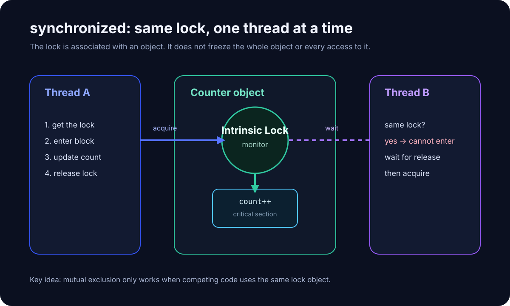

# synchronized: What Does It Actually Lock?

> [!abstract] One problem only
>
> **What does Java synchronized actually lock?**
>
> Once this is clear, synchronized methods, synchronized blocks, and static synchronized methods become variations of one model rather than three unrelated rules.

The previous note showed that count++ is a read-modify-write compound operation and can lose updates when two threads interleave.

Now we protect the critical section.

---

# 0. The answer first

> **synchronized does not lock a method or variable. A thread acquires the intrinsic lock associated with an object, often described using the object's monitor.**

The key question is:

> **Are competing threads using the same lock object?**

~~~text
Thread A ──┐
           ├──> same lock object
Thread B ──┘
                 ↓
          at most one owner
          at a time
~~~

---

# 1. Connect it to lost update

Before:

~~~java
class Counter {
    int count = 0;

    void increment() {
        count++;
    }
}
~~~

Possible interleaving:

~~~text
A read 0
B read 0
A write 1
B write 1
~~~

Now:

~~~java
class Counter {
    int count = 0;

    synchronized void increment() {
        count++;
    }
}
~~~

Conceptually:

~~~text
Thread A acquires the lock
→ executes count++
→ releases the lock
→ Thread B acquires the same lock
→ executes count++
~~~

The critical section is no longer entered concurrently by threads competing for the same monitor.

---

# 2. The core picture

Do not picture two threads fighting over the method itself.

Picture them fighting over:

~~~text
the intrinsic lock associated with one Counter object
~~~

So the first question when reading synchronized code is always:

> **Which object is the lock?**

---

# 3. What does a synchronized instance method lock?

~~~java
class Counter {
    synchronized void increment() {
        count++;
    }
}
~~~

For the mental model, treat it roughly as:

~~~java
class Counter {
    void increment() {
        synchronized (this) {
            count++;
        }
    }
}
~~~

An instance synchronized method therefore uses the lock associated with the current receiver object.

If:

~~~java
Counter counter = new Counter();
counter.increment();
~~~

the relevant lock is associated with counter, not with the method name increment.

---

# 4. Why "locking the method" is a bad model

~~~java
class Counter {
    synchronized void increment() {
        count++;
    }

    synchronized void reset() {
        count = 0;
    }
}
~~~

On the same Counter instance:

~~~text
increment() → this
reset()     → this
~~~

So two different methods can block each other because they use the same lock object.

The useful question is not "which method is locked?"

It is:

> **Which lock object does this code use?**

---

# 5. What does synchronized(lock) mean?

~~~java
class Counter {
    private final Object lock = new Object();
    private int count = 0;

    void increment() {
        synchronized (lock) {
            count++;
        }
    }
}
~~~

Before entering the block, the thread must acquire the intrinsic lock associated with lock.

This form makes the lock identity explicit and lets you keep the critical section small.

---

# 6. The most important rule: same lock

~~~java
private final Object lockA = new Object();
private final Object lockB = new Object();

void methodA() {
    synchronized (lockA) {
        // ...
    }
}

void methodB() {
    synchronized (lockB) {
        // ...
    }
}
~~~

Because:

~~~text
lockA != lockB
~~~

the blocks do not mutually exclude each other.

Compress the rule:

~~~text
same monitor
→ mutual exclusion

different monitor
→ no mutual exclusion between them
~~~

---

# 7. Do two Counter instances block each other?

~~~java
Counter a = new Counter();
Counter b = new Counter();

Thread A → a.increment()
Thread B → b.increment()
~~~

For synchronized instance methods:

~~~text
a.increment() → lock associated with a
b.increment() → lock associated with b
~~~

Different receiver objects mean different intrinsic locks, so the threads can enter at the same time.

---

# 8. What does static synchronized lock?

~~~java
class Counter {
    static synchronized void resetAll() {
        // ...
    }
}
~~~

There is no receiver instance.

A static synchronized method uses the Class object associated with the class.

For the mental model:

~~~java
static void resetAll() {
    synchronized (Counter.class) {
        // ...
    }
}
~~~

| Form | Lock used |
|---|---|
| synchronized instance method | current receiver |
| synchronized(lock) | explicit lock object |
| static synchronized method | the class's Class object |

---

# 9. Locking an object does not freeze the object

~~~java
class Counter {
    int count = 0;

    synchronized void increment() {
        count++;
    }

    void unsafeReset() {
        count = 0;
    }
}
~~~

If Thread A is inside increment(), Thread B can still execute unsafeReset() because that method does not acquire the same lock.

The accurate model is:

> **Only code that participates by acquiring the same lock is coordinated by that lock.**

---

# 10. First capability: mutual exclusion

Mutual exclusion means:

~~~text
same lock
+
same time
=
at most one owning thread
~~~

For:

~~~java
synchronized (lock) {
    count++;
}
~~~

another thread that must acquire that same lock cannot interleave inside the protected read-modify-write sequence.

That is how synchronized prevents the lost-update pattern.

---

# 11. Second capability: visibility and happens-before

synchronized is not only about waiting.

JMM gives an important rule:

> An unlock of a monitor happens-before a subsequent lock of that same monitor.

Practical picture:

~~~text
Thread A
changes shared state
inside synchronized
↓
releases lock

Thread B
later acquires same lock
↓
gets the required visibility / ordering guarantees
~~~

So synchronized provides:

~~~text
mutual exclusion
+
memory visibility / ordering
~~~

---

# 12. Minimal visibility example

~~~java
class State {
    private final Object lock = new Object();
    private int value = 0;

    void write() {
        synchronized (lock) {
            value = 42;
        }
    }

    int read() {
        synchronized (lock) {
            return value;
        }
    }
}
~~~

When Thread A releases lock after write(), and Thread B subsequently acquires that same lock inside read(), the synchronization actions establish the relevant happens-before relationship.

Again, the phrase "same lock" matters.

---

# 13. Intrinsic locks are reentrant

~~~java
class Demo {
    synchronized void outer() {
        inner();
    }

    synchronized void inner() {
        // ...
    }
}
~~~

The same thread can enter outer(), keep the lock, and then enter inner() even though inner() requires the same lock.

Java intrinsic locks are reentrant.

No need to study the internal implementation yet.

---

# 14. Why a synchronized block is often better than a whole method

~~~java
synchronized void load() {
    prepareRequest();
    callNetwork();
    updateCache();
}
~~~

This holds the lock for the whole method.

If only the cache update needs protection:

~~~java
void load() {
    prepareRequest();
    callNetwork();

    synchronized (cacheLock) {
        updateCache();
    }
}
~~~

A useful rule:

> **Protect the smallest region that still preserves the complete concurrency invariant.**

A larger scope can increase waiting and reduce concurrency.

---

# 15. Android example: shared cache updated by background work

~~~java
class UserCache {
    private final Object lock = new Object();
    private final Map<String, User> users = new HashMap<>();

    void put(User user) {
        synchronized (lock) {
            users.put(user.id, user);
        }
    }

    User get(String id) {
        synchronized (lock) {
            return users.get(id);
        }
    }
}
~~~

When work arrives from an Executor, Binder thread, HandlerThread, coroutine dispatcher, network callback, or database callback, ask:

~~~text
Do these execution contexts touch the same mutable state?
Which object protects that state?
Do all competing entry points use the same lock?
~~~

---

# 16. Five common wrong models

1. synchronized locks a method.  
   No. It acquires an object-associated lock.

2. Any synchronized code blocks any other synchronized code.  
   No. The lock objects must be the same.

3. Once one thread locks an object, nobody can access that object.  
   No. Unsynchronized code can still access it.

4. synchronized instance methods on different instances block each other.  
   Normally no. Different receiver objects mean different locks.

5. A larger lock scope is always better.  
   It can create unnecessary contention and longer waiting.

---

# 17. Practical reading checklist

Whenever you see synchronized, ask:

~~~text
1. What is the shared mutable state?
2. Which code paths read or write it?
3. What exactly is the lock object?
4. Do all competing paths use the same lock?
5. Is the critical section too large or too small?
~~~

---

# 18. Minimal exercise

Start from:

~~~java
class Counter {
    int count = 0;

    void increment() {
        count++;
    }
}
~~~

Create two versions.

Version A: synchronized instance method.

Version B: synchronized block with:

~~~java
private final Object lock = new Object();
~~~

Run two threads, each incrementing 100000 times.

Expected:

~~~text
expected = 200000
actual   = 200000
~~~

The real target is being able to point to the exact lock object and explain why both threads must compete for it.

---

# 19. Not now

Do not dive into:

- object headers
- Mark Word
- monitorenter / monitorexit implementation details
- HotSpot ObjectMonitor source
- historical biased locking
- lightweight-locking internals
- OS mutex / futex details
- spin strategies
- JVM lock optimizations

Those answer "how is the lock implemented?"

This note answers the more useful first question:

> **What does synchronized coordinate in Java semantics?**

---

# 20. Primary sources

> Verified: 2026-10-16  
> Java SE 27.

1. **The Java Language Specification, Java SE 27 · §17.1 Synchronization**  
   https://docs.oracle.com/javase/specs/jls/se27/html/jls-17.html#jls-17.1

2. **JLS §14.19 The synchronized Statement**  
   https://docs.oracle.com/javase/specs/jls/se27/html/jls-14.html#jls-14.19

3. **JLS §8.4.3.6 synchronized Methods**  
   https://docs.oracle.com/javase/specs/jls/se27/html/jls-8.html#jls-8.4.3.6

4. **JLS §17.4.5 Happens-before Order**  
   https://docs.oracle.com/javase/specs/jls/se27/html/jls-17.html#jls-17.4.5

---

# 21. After this note

Continue with:

~~~text
[[volatile: what does it actually guarantee?]]
~~~

The next note solves one specific question:

> **Why can synchronized make count++ safe while volatile int count still cannot?**
